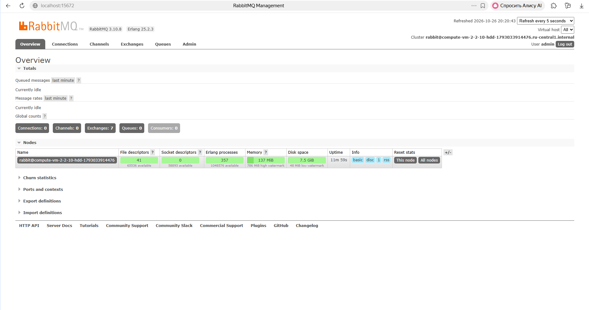
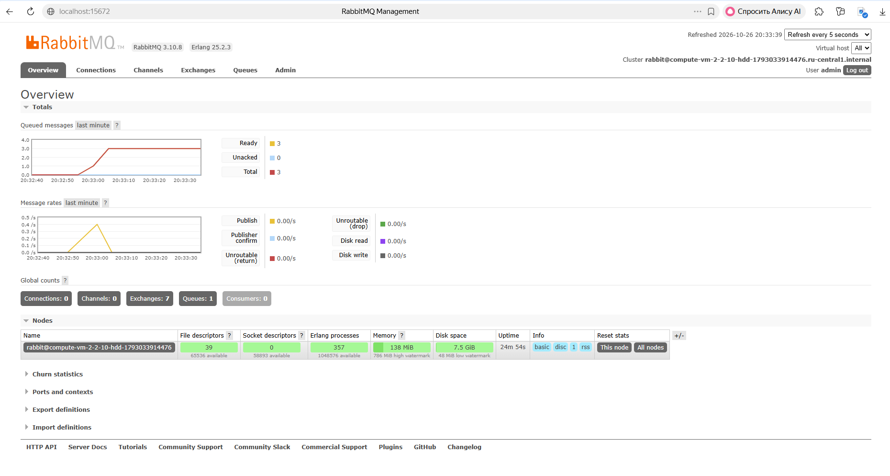
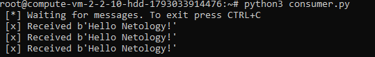
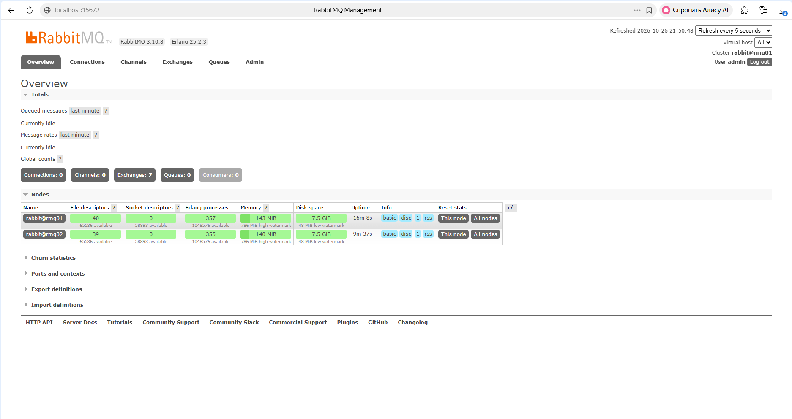
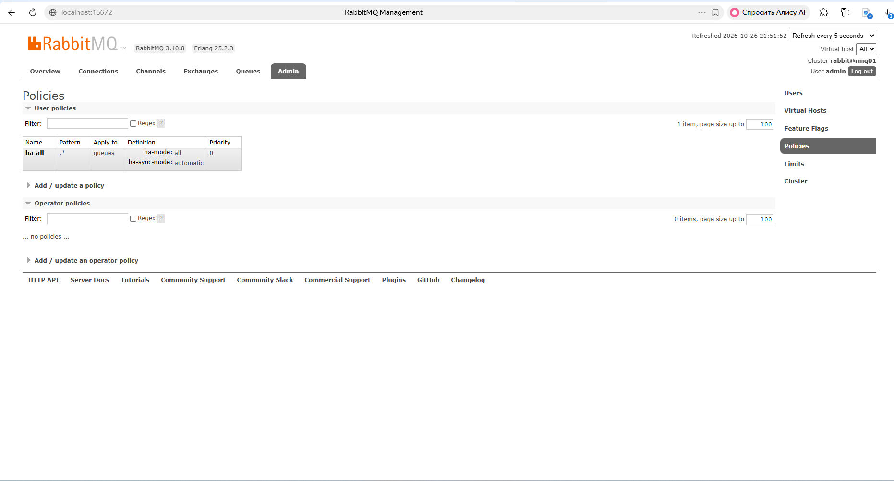
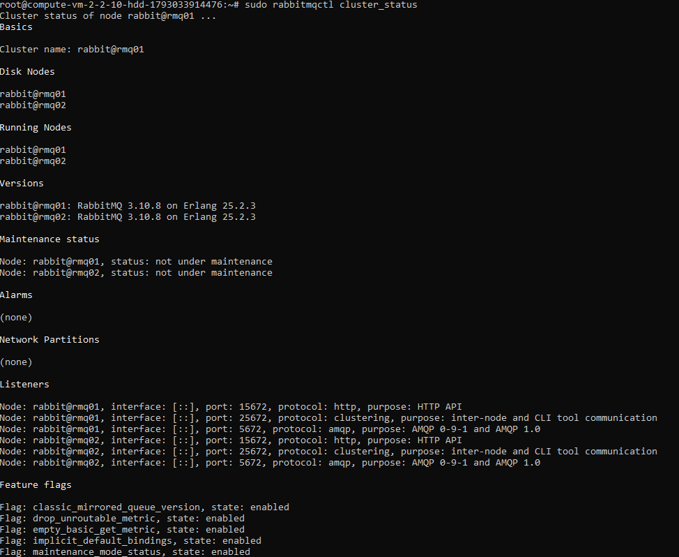
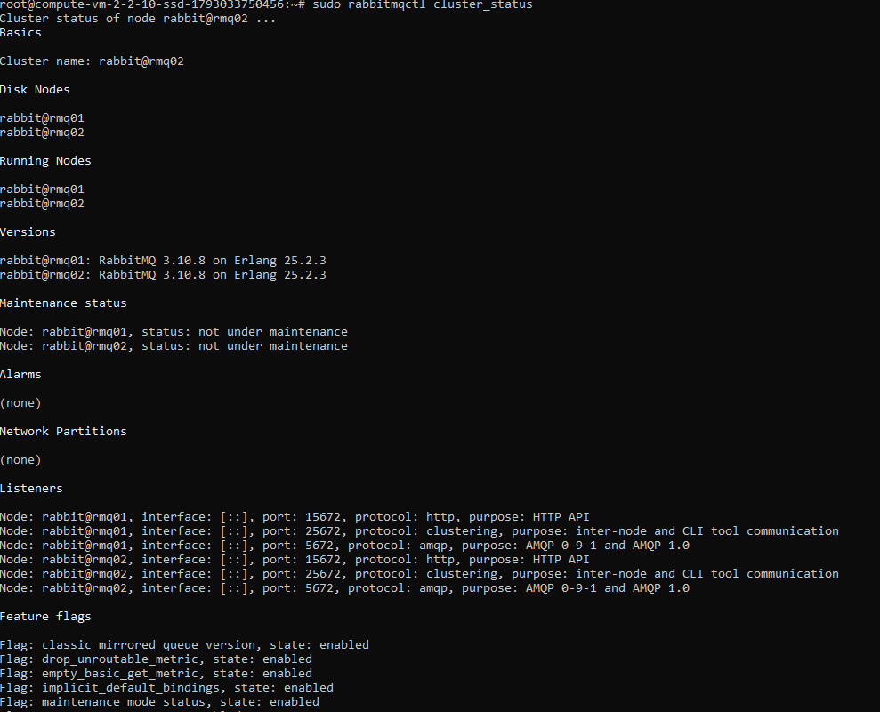
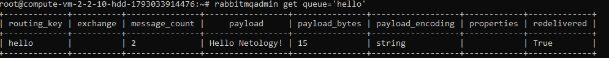
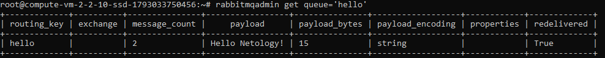
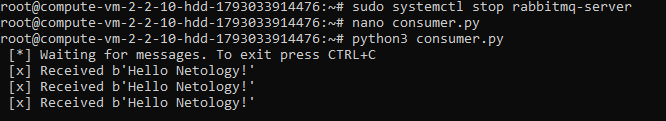

# Домашнее задание к занятию «Очереди RabbitMQ»

Стенд развёрнут в **Yandex Cloud** на двух виртуальных машинах с **Debian 12**:

| Хост    | Назначение         | Версия                          |
|---------|--------------------|---------------------------------|
| `rmq01` | RabbitMQ, нода 1   | RabbitMQ 3.10.8 / Erlang 25.2.3 |
| `rmq02` | RabbitMQ, нода 2   | RabbitMQ 3.10.8 / Erlang 25.2.3 |

> В задании 1–2 работала только первая ВМ, поэтому в веб-интерфейсе на этих скриншотах нода ещё называется `rabbit@compute-vm-...`; перед сборкой кластера она переименована в `rmq01`.

---

## Задание 1. Установка RabbitMQ

Установка RabbitMQ и management plug-in:

```bash
sudo apt update
sudo apt install -y rabbitmq-server
sudo systemctl enable --now rabbitmq-server

sudo rabbitmq-plugins enable rabbitmq_management
sudo rabbitmq-plugins list | grep management
```

Создание администратора для веб-интерфейса (пользователь `guest` пускает только с localhost):

```bash
sudo rabbitmqctl add_user admin '<password>'
sudo rabbitmqctl set_user_tags admin administrator
sudo rabbitmqctl set_permissions -p / admin ".*" ".*" ".*"
```

Доступ к веб-интерфейсу — через SSH-туннель, без открытия порта наружу:

```bash
ssh -L 15672:localhost:15672 rmq@<public_ip>
```

**Веб-интерфейс RabbitMQ:**



---

## Задание 2. Отправка и получение сообщений

Установка Pika (на Debian 12 — из пакетов, т. к. `pip install` вне venv запрещён PEP 668):

```bash
sudo apt install -y python3-pika
```

Отправка сообщений:

```bash
python3 producer.py
```

**Очередь `hello` в веб-интерфейсе:**



Получение сообщений:

```bash
python3 consumer.py
```

**Результат работы consumer.py:**



---

## Задание 3. Подготовка HA кластера

### Имена хостов и /etc/hosts

На каждой ВМ задано имя и добавлены записи в `/etc/hosts` (внутренние IP Yandex Cloud):

```bash
sudo hostnamectl set-hostname rmq01   # на второй ВМ — rmq02
echo "preserve_hostname: true" | sudo tee /etc/cloud/cloud.cfg.d/99-hostname.cfg
```

```
$ cat /etc/hosts
<internal_ip_1> rmq01
<internal_ip_2> rmq02
```

В группе безопасности разрешён трафик между ВМ по портам `4369`, `25672`, `5672`, `15672`.

### Сборка кластера

На обеих нодах выставлен одинаковый Erlang cookie (`/var/lib/rabbitmq/.erlang.cookie`, владелец `rabbitmq`, права `400`).

Присоединение `rmq02` к `rmq01`:

```bash
sudo rabbitmqctl stop_app
sudo rabbitmqctl reset
sudo rabbitmqctl join_cluster rabbit@rmq01
sudo rabbitmqctl start_app
```

### Политика ha-all

```bash
sudo rabbitmqctl set_policy ha-all ".*" '{"ha-mode":"all","ha-sync-mode":"automatic"}' --apply-to queues
```

**Ноды кластера в веб-интерфейсе:**



**Политика ha-all:**



### Вывод `rabbitmqctl cluster_status`

**rmq01:**



**rmq02:**



### Проверка зеркалирования очереди

Установка `rabbitmqadmin` (поставляется management plug-in):

```bash
wget http://localhost:15672/cli/rabbitmqadmin
chmod +x rabbitmqadmin && sudo mv rabbitmqadmin /usr/local/bin/
```

После запуска `producer.py` сообщение доступно на обеих нодах:

```bash
rabbitmqadmin get queue='hello'
```

**rmq01:**



**rmq02:**



### Отказ ноды

Нода `rmq01`, к которой подключался `producer.py`, остановлена:

```bash
sudo systemctl stop rabbitmq-server
```

В `consumer.py` подключение переключено на `rmq02` (удалённо `guest` не допускается, поэтому используется `admin`):

```python
credentials = pika.PlainCredentials('admin', '<password>')
connection = pika.BlockingConnection(pika.ConnectionParameters('rmq02', credentials=credentials))
```

**Результат работы consumer.py при отключённой rmq01:**



Все сообщения получены со второй ноды — благодаря политике `ha-all` очередь была зеркалирована, и данные пережили отказ ноды.
